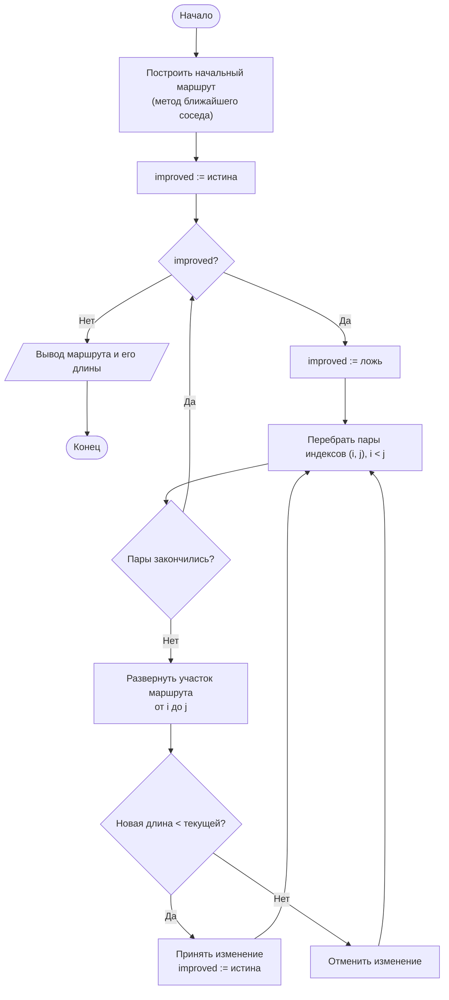

# Лабораторная работа № 12

## Точные и эвристические алгоритмы решения труднорешаемых задач комбинаторной оптимизации

**Дисциплина:** Теория алгоритмов
**Направление подготовки:** 38.03.05 «Бизнес-информатика»
**Курс:** 2
**Объём:** 4 академических часа
**Язык реализации:** Python 3.10+
**Предварительные требования:** ЛР № 8 (жадные алгоритмы), ЛР № 9, № 10 (графы)

---

## 1. Цель и задачи работы

**Цель работы:** изучить класс задач, для которых точные алгоритмы практически неприменимы, и освоить приёмы построения приближённых решений — конструктивные эвристики и локальный поиск.

**Задачи:**

1. Изучить понятия полиномиальной и экспоненциальной сложности, классов P и NP, NP-полноты и NP-трудности.
2. Реализовать точный алгоритм полного перебора и экспериментально установить предельную размерность задачи.
3. Реализовать конструктивную эвристику и алгоритм локального поиска.
4. Оценить качество приближённых решений относительно точного оптимума на малых размерностях.
5. Исследовать соотношение «время — качество» и сформулировать рекомендации по выбору метода.

---

## 2. Теоретическая часть

### 2.1. Полиномиальная и экспоненциальная сложность

Алгоритм считается **эффективным**, если его трудоёмкость ограничена полиномом от размера входа: $O(n)$, $O(n \log n)$, $O(n^2)$, $O(n^3)$. Экспоненциальные оценки $O(2^n)$ и $O(n!)$ означают практическую неприменимость уже при умеренных $n$.

Оценка числа операций при частоте $10^9$ операций в секунду:

| $n$ | $n^2$ | $2^n$ | $n!$ |
|---|---|---|---|
| 10 | 100 | 1024 | 3,6 · 10⁶ |
| 20 | 400 | 10⁶ | 2,4 · 10¹⁸ (≈ 77 лет) |
| 50 | 2500 | 10¹⁵ (≈ 13 дней) | больше числа атомов в наблюдаемой Вселенной |

Отсюда следует важный вывод: **рост производительности вычислительной техники не решает проблему**. Удвоение быстродействия увеличивает доступный размер задачи с факториальной сложностью примерно на единицу.

### 2.2. Классы P и NP

| Класс | Определение (неформально) |
|---|---|
| P | Задачи, для которых известен алгоритм решения за полиномиальное время |
| NP | Задачи, для которых предъявленное решение можно **проверить** за полиномиальное время |
| NP-полные | Самые трудные задачи класса NP: если хотя бы одна из них решается за полиномиальное время, то и все задачи NP решаются так же |
| NP-трудные | Задачи не легче NP-полных; могут не принадлежать NP (например, оптимизационные версии) |

Вопрос о равенстве $\text{P} = \text{NP}$ остаётся открытым и входит в число «проблем тысячелетия». Практическое следствие: для NP-трудной задачи не следует ожидать точного полиномиального алгоритма, и разумной стратегией является приближённое решение.

Примеры NP-трудных задач: коммивояжёра, о рюкзаке 0/1, об упаковке в контейнеры, о раскраске графа, о составлении расписания.

### 2.3. Задача коммивояжёра

Дано $n$ городов и матрица расстояний $D$. Требуется найти замкнутый маршрут, проходящий через каждый город ровно один раз, с минимальной суммарной длиной.

Число различных маршрутов при фиксированном начальном городе равно $(n-1)!/2$ для симметричной матрицы. Следовательно, полный перебор имеет сложность $\Theta(n!)$.

**Точные методы:**

| Метод | Сложность | Практический предел |
|---|---|---|
| Полный перебор | $\Theta(n!)$ | $n \le 11$ |
| Динамическое программирование (Хелда — Карпа) | $\Theta(n^2 2^n)$ | $n \le 20$ |
| Метод ветвей и границ | Экспоненциальный в худшем случае | Зависит от данных |

### 2.4. Конструктивные эвристики

**Метод ближайшего соседа.** Из текущего города переходим в ближайший ещё не посещённый. Трудоёмкость $\Theta(n^2)$. Метод прост, но «жаден»: последние переходы часто оказываются очень длинными, поскольку пропущенные города приходится объединять в конце.

Для метрической задачи коммивояжёра (выполняется неравенство треугольника) доказана оценка

$$\frac{L_{\text{NN}}}{L_{\text{опт}}} \le \frac{1}{2}\left(\lceil \log_2 n \rceil + 1\right),$$

то есть гарантия качества ухудшается с ростом $n$. На практике отклонение обычно составляет 15–25 %.

### 2.5. Локальный поиск и метод 2-opt

**Локальный поиск** начинается с некоторого допустимого решения и последовательно улучшает его небольшими изменениями (в пределах *окрестности*), пока улучшения возможны.

**Окрестность 2-opt.** Из маршрута удаляются два ребра, и участок между ними разворачивается. Если новая длина меньше, замена принимается. Проверка всех пар рёбер требует $\Theta(n^2)$ операций на один проход; проходы повторяются до отсутствия улучшений.

Результат локального поиска — **локальный оптимум**: решение, которое нельзя улучшить в пределах данной окрестности, но которое может уступать глобальному оптимуму. Типичное отклонение 2-opt от оптимума составляет около 5 %.

Способы выхода из локального оптимума: многократный запуск из разных начальных решений, расширение окрестности (3-opt), метаэвристики (имитация отжига, генетические алгоритмы, поиск с запретами).

### 2.6. Соотношение «время — качество»

| Метод | Время | Качество | Применимость |
|---|---|---|---|
| Полный перебор | $\Theta(n!)$ | Оптимум | $n \le 11$ |
| Ближайший сосед | $\Theta(n^2)$ | 15–25 % хуже оптимума | Любое $n$ |
| Ближайший сосед + 2-opt | $\Theta(n^2)$ за проход | около 5 % хуже оптимума | До десятков тысяч |
| Многократный запуск + 2-opt | Управляемое | Лучше одиночного запуска | Определяется бюджетом времени |

Ключевой практический принцип: при работе с NP-трудными задачами выбирается не «лучший алгоритм», а приемлемое соотношение между качеством решения и допустимым временем расчёта.

---

## 3. Порядок выполнения работы

1. Изучить теоретическую часть.
2. Реализовать генерацию исходных данных согласно варианту (табл. 1).
3. Реализовать точный алгоритм (полный перебор либо ДП Хелда — Карпа) и измерить время при возрастающем $n$. Определить предельное $n$, при котором расчёт укладывается в 10 с. Построить график в логарифмической шкале.
4. Реализовать конструктивную эвристику варианта.
5. Реализовать локальный поиск (2-opt или аналог для своей задачи).
6. На размерностях, где точное решение доступно, вычислить отклонение эвристик от оптимума по серии из не менее чем 30 наборов данных.
7. На большой размерности сравнить эвристики между собой по качеству и времени.
8. Оформить отчёт с рекомендацией по выбору метода.

---

## 4. Варианты заданий

**Таблица 1. Исходные данные**

| № | Задача | Точный метод | Конструктивная эвристика | Локальный поиск | Размерности | Доп. |
|---|---|---|---|---|---|---|
| 0 | Коммивояжёр (на плоскости) | Полный перебор | Ближайший сосед | 2-opt | 5…10 (точно), 100 (эвристики) | — |
| 1 | Коммивояжёр | Полный перебор | Ближайший сосед | Перестановка двух городов | 5…10, 200 | М1 |
| 2 | Упаковка в контейнеры | Полный перебор | Первый подходящий | Перенос предмета | 10…16, 500 | М2 |
| 3 | Коммивояжёр | ДП Хелда — Карпа | Ближайший сосед | 2-opt | до 16, 300 | М3 |
| 4 | Раскраска графа | Полный перебор | Жадная по степеням | Перекраска вершины | 8…12, 200 | М4 |
| 5 | Коммивояжёр | Полный перебор | Случайный маршрут | 2-opt | 5…10, 150 | М5 |
| 6 | Упаковка в контейнеры | Полный перебор | Наилучший подходящий | Обмен двух предметов | 10…16, 400 | М6 |
| 7 | Составление расписания на 2 машинах | Полный перебор | Наибольшая длительность первой | Перенос работы | 10…18, 300 | М7 |
| 8 | Коммивояжёр | Полный перебор | Ближайший сосед | 2-opt | 5…11, 250 | М1 |
| 9 | Максимальная клика | Полный перебор | Жадное наращивание | Замена вершины | 10…16, 100 | М2 |
| 10 | Коммивояжёр | ДП Хелда — Карпа | Ближайший сосед | 3-opt (упрощённый) | до 15, 200 | М3 |
| 11 | Упаковка в контейнеры | Полный перебор | Первый подходящий с сортировкой | Перенос предмета | 10…15, 600 | М4 |
| 12 | Коммивояжёр | Полный перебор | Жадное добавление рёбер | 2-opt | 5…10, 300 | М5 |
| 13 | Раскраска графа | Полный перебор | Жадная в порядке убывания степеней | Перекраска | 8…12, 250 | М6 |
| 14 | Расписание на 3 машинах | Полный перебор | Наименее загруженная машина | Перенос работы | 9…15, 200 | М7 |
| 15 | Коммивояжёр | Полный перебор | Ближайший сосед из лучшей стартовой точки | 2-opt | 5…10, 200 | М1 |
| 16 | Упаковка в контейнеры | Полный перебор | Наихудший подходящий | Обмен предметов | 10…16, 500 | М2 |
| 17 | Коммивояжёр | ДП Хелда — Карпа | Ближайший сосед | 2-opt | до 17, 400 | М3 |
| 18 | Максимальное независимое множество | Полный перебор | Жадный по минимальной степени | Замена вершины | 10…16, 150 | М4 |
| 19 | Коммивояжёр | Полный перебор | Случайный маршрут | 2-opt с многократным запуском | 5…10, 250 | М5 |
| 20 | Упаковка в контейнеры | Полный перебор | Первый подходящий | Перенос и обмен | 10…15, 700 | М6 |
| 21 | Расписание на 2 машинах | Полный перебор | Жадный по убыванию | Обмен двух работ | 10…18, 400 | М7 |
| 22 | Коммивояжёр | Полный перебор | Ближайший сосед | 2-opt | 5…11, 350 | М1 |
| 23 | Раскраска графа | Полный перебор | Жадная случайная | Перекраска | 8…12, 300 | М2 |
| 24 | Коммивояжёр | ДП Хелда — Карпа | Жадное добавление рёбер | 2-opt | до 16, 500 | М3 |
| 25 | Упаковка в контейнеры | Полный перебор | Наилучший подходящий с сортировкой | Обмен предметов | 10…16, 800 | М4 |
| 26 | Максимальная клика | Полный перебор | Жадное наращивание | Замена двух вершин | 10…15, 120 | М5 |
| 27 | Коммивояжёр | Полный перебор | Ближайший сосед | 2-opt | 5…10, 600 | М6 |
| 28 | Расписание на 3 машинах | Полный перебор | Наименее загруженная машина | Обмен работ | 9…14, 350 | М7 |
| 29 | Коммивояжёр | Полный перебор | Случайный маршрут | 2-opt | 5…10, 450 | М1 |
| 30 | Коммивояжёр и упаковка | Полный перебор | Ближайший сосед; первый подходящий | 2-opt; перенос | 5…10, 300 | М3 |

**Таблица 2. Дополнительные задания**

| Код | Содержание |
|---|---|
| М1 | Реализовать **многократный запуск** локального поиска из разных начальных решений. Построить график зависимости лучшего найденного решения от числа запусков |
| М2 | Реализовать **имитацию отжига** и сравнить её с локальным поиском при равном бюджете времени |
| М3 | Реализовать **метод ветвей и границ** и сравнить число рассмотренных вариантов с полным перебором |
| М4 | Исследовать зависимость качества эвристики от размерности: построить график среднего отклонения при $n = 6, 7, 8, 9$ (относительно точного оптимума) |
| М5 | Визуализировать маршрут (или решение) до и после локального поиска средствами `matplotlib` |
| М6 | Построить график «время — качество»: при ограничении времени 0,1 с, 1 с, 10 с определить лучшее достижимое решение каждым методом |
| М7 | Сформулировать прикладную постановку (маршрут курьера, раскрой материала, распределение смен) и оценить экономический эффект перехода от эвристики к улучшенному решению |

---

## 5. Требования к отчёту

1. Титульный лист.
2. Цель работы и задание варианта.
3. Постановка задачи, обоснование её принадлежности к классу NP-трудных.
4. Описание точного алгоритма и обеих эвристик.
5. Блок-схема локального поиска.
6. Листинг программы.
7. Таблица роста времени точного метода и график в логарифмической шкале.
8. Таблица отклонений эвристик от оптимума на малых размерностях.
9. Результаты на большой размерности с указанием времени.
10. Выводы с рекомендацией по выбору метода.

---

## 6. Пример оформления отчёта (вариант 0)

### 6.1. Задание

Для задачи коммивояжёра на плоскости реализовать полный перебор, метод ближайшего соседа и улучшение 2-opt. Определить предельное $n$ для точного метода, оценить отклонение эвристик от оптимума при $n = 5 \ldots 10$ и сравнить их на задаче со 100 городами.

### 6.2. Блок-схема локального поиска 2-opt



### 6.3. Листинг программы

```python
"""
Лабораторная работа № 12. Вариант 0.
Задача коммивояжёра: полный перебор, ближайший сосед, локальный поиск 2-opt.
"""
import math
import random
import statistics
import time
from itertools import permutations


def generate_cities(n, seed=42):
    """n случайных точек на плоскости 100 × 100."""
    rng = random.Random(seed)
    return [(rng.uniform(0, 100), rng.uniform(0, 100)) for _ in range(n)]


def distance_matrix(cities):
    n = len(cities)
    D = [[0.0] * n for _ in range(n)]
    for i in range(n):
        for j in range(i + 1, n):
            d = math.dist(cities[i], cities[j])
            D[i][j] = D[j][i] = d
    return D


def tour_length(tour, D):
    """Длина замкнутого маршрута."""
    return sum(D[tour[i]][tour[(i + 1) % len(tour)]] for i in range(len(tour)))


def brute_force(D):
    """Полный перебор: Θ(n!). Первый город фиксирован."""
    n = len(D)
    best_tour, best_len = None, float("inf")
    for perm in permutations(range(1, n)):
        tour = (0,) + perm
        length = tour_length(tour, D)
        if length < best_len:
            best_tour, best_len = tour, length
    return list(best_tour), best_len


def nearest_neighbour(D, start=0):
    """Конструктивная эвристика: Θ(n²)."""
    n = len(D)
    unvisited = set(range(n)) - {start}
    tour = [start]
    while unvisited:
        last = tour[-1]
        nxt = min(unvisited, key=lambda c: D[last][c])
        tour.append(nxt)
        unvisited.remove(nxt)
    return tour, tour_length(tour, D)


def two_opt(tour, D, max_passes=100):
    """Локальный поиск в окрестности 2-opt."""
    n = len(tour)
    tour = tour[:]
    best = tour_length(tour, D)
    for _ in range(max_passes):
        improved = False
        for i in range(1, n - 1):
            for j in range(i + 1, n):
                # разворот участка [i, j]
                delta = (D[tour[i - 1]][tour[j]] + D[tour[i]][tour[(j + 1) % n]]
                         - D[tour[i - 1]][tour[i]] - D[tour[j]][tour[(j + 1) % n]])
                if delta < -1e-12:
                    tour[i:j + 1] = reversed(tour[i:j + 1])
                    best += delta
                    improved = True
        if not improved:
            break
    return tour, best


if __name__ == "__main__":
    # --- 1. Рост времени полного перебора ---
    print(f"{'n':>4}{'вариантов (n−1)!':>18}{'перебор, с':>13}")
    for n in range(5, 11):
        D = distance_matrix(generate_cities(n))
        t0 = time.perf_counter(); brute_force(D)
        t = time.perf_counter() - t0
        print(f"{n:>4}{math.factorial(n - 1):>18}{t:>13.4f}")

    # --- 2. Качество эвристик относительно оптимума ---
    print(f"\n{'n':>4}{'отклонение NN, %':>20}{'отклонение NN+2opt, %':>24}"
          f"{'2opt достиг оптимума':>24}")
    TRIALS = 20
    for n in [6, 8, 9]:
        dev_nn, dev_opt, hits = [], [], 0
        for trial in range(TRIALS):
            D = distance_matrix(generate_cities(n, seed=100 + trial))
            _, opt = brute_force(D)
            _, l_nn = nearest_neighbour(D)
            tour_nn, _ = nearest_neighbour(D)
            _, l_2opt = two_opt(tour_nn, D)
            dev_nn.append((l_nn - opt) / opt * 100)
            dev_opt.append((l_2opt - opt) / opt * 100)
            hits += abs(l_2opt - opt) < 1e-9
        print(f"{n:>4}{statistics.mean(dev_nn):>20.2f}"
              f"{statistics.mean(dev_opt):>24.2f}{hits / TRIALS * 100:>23.0f}%")

    # --- 3. Большая размерность ---
    N = 100
    D = distance_matrix(generate_cities(N))
    t0 = time.perf_counter(); tour_nn, l_nn = nearest_neighbour(D)
    t_nn = time.perf_counter() - t0
    t0 = time.perf_counter(); tour_2, l_2 = two_opt(tour_nn, D)
    t_2 = time.perf_counter() - t0

    rng = random.Random(0)
    random_tour = list(range(N)); rng.shuffle(random_tour)
    l_rand = tour_length(random_tour, D)

    print(f"\nN = {N} городов:")
    print(f"  Случайный маршрут:     длина {l_rand:9.1f}")
    print(f"  Ближайший сосед:       длина {l_nn:9.1f}, время {t_nn:.4f} с")
    print(f"  Ближайший сосед+2-opt: длина {l_2:9.1f}, время {t_2:.4f} с "
          f"(улучшение {(l_nn - l_2) / l_nn * 100:.1f} %)")
    print(f"  Оценка времени полного перебора: {math.factorial(N - 1):.2e} вариантов")
```

### 6.4. Результаты

Измерения выполнены в среде Linux, Python 3.12.

**Таблица 3. Рост времени полного перебора**

| $n$ | Число маршрутов $(n-1)!$ | Время, с |
|---|---|---|
| 5 | 24 | 0,0000 |
| 6 | 120 | 0,0001 |
| 7 | 720 | 0,0006 |
| 8 | 5040 | 0,0047 |
| 9 | 40 320 | 0,0485 |
| 10 | 362 880 | 0,3948 |

Каждое увеличение $n$ на единицу умножает время примерно в $n$ раз. Экстраполяция: $n = 12$ — около 50 с, $n = 15$ — около 30 часов, $n = 20$ — свыше $10^9$ лет.

**Таблица 4. Отклонение эвристик от точного оптимума (по 20 наборов данных)**

| $n$ | Ближайший сосед, % | Ближайший сосед + 2-opt, % | Доля достижения оптимума 2-opt |
|---|---|---|---|
| 6 | 5,39 | 0,02 | 90 % |
| 8 | 7,41 | 0,05 | 95 % |
| 9 | 8,31 | 0,50 | 75 % |

**Таблица 5. Результаты при $N = 100$ городов**

| Метод | Длина маршрута | Время, с | Относительно случайного |
|---|---|---|---|
| Случайный маршрут | 5294,0 | — | 100 % |
| Ближайший сосед | 1062,8 | 0,0003 | 20,1 % |
| Ближайший сосед + 2-opt | 858,8 | 0,0025 | 16,2 % |

Улучшение 2-opt относительно начального маршрута составило 19,2 %. Полный перебор при $N = 100$ потребовал бы рассмотрения $9{,}33 \cdot 10^{155}$ маршрутов.

### 6.5. Выводы (образец)

1. Время полного перебора растёт факториально: увеличение $n$ на единицу умножает время примерно на $n$. Экстраполяция показывает, что при $n = 15$ расчёт занял бы годы, а при $n = 20$ — время, превышающее возраст Вселенной. Это иллюстрирует практическую неприменимость точных переборных методов.
2. Метод ближайшего соседа даёт решение мгновенно, но его отклонение от оптимума заметно. Причина в «жадности»: последние переходы вынужденно соединяют удалённые пропущенные города.
3. Локальный поиск 2-opt существенно улучшает начальное решение, оставаясь полиномиальным: среднее отклонение снизилось с 5–8 % до долей процента. На малых размерностях он достигает точного оптимума в 75–95 % наборов, однако гарантии этого нет: результатом является локальный оптимум.
4. На задаче со 100 городами точное решение недостижимо в принципе, а эвристики дают приемлемый результат за доли секунды. При этом улучшение 2-opt относительно начального маршрута составляет заметную долю длины.
5. Практический вывод: для NP-трудных задач следует формулировать требование не «найти оптимум», а «найти решение не хуже заданного качества за приемлемое время». Такой подход применяется в системах маршрутизации, планирования производства и раскроя материалов.

---

## 7. Контрольные вопросы

1. Чем полиномиальная сложность отличается от экспоненциальной с практической точки зрения?
2. Почему рост быстродействия вычислительной техники не решает проблему труднорешаемых задач?
3. Дайте неформальное определение классов P и NP. В чём состоит вопрос $\text{P} = \text{NP}$?
4. Что означает NP-полнота задачи? Чем NP-трудная задача отличается от NP-полной?
5. Сколько различных маршрутов существует в задаче коммивояжёра с $n$ городами?
6. Опишите метод ближайшего соседа. В чём причина его систематической ошибки?
7. Что такое окрестность решения и локальный оптимум?
8. Как устроено преобразование 2-opt? Какова трудоёмкость одного прохода?
9. Какими способами можно выйти из локального оптимума?
10. Как обосновать выбор приближённого алгоритма перед заказчиком, которому требуется «оптимальное» решение?

---

## 8. Рекомендуемая литература

1. Кормен Т., Лейзерсон Ч., Ривест Р., Штайн К. Алгоритмы: построение и анализ. — 3-е изд. — М.: Вильямс, 2013. — Гл. 34, 35.
2. Гэри М., Джонсон Д. Вычислительные машины и труднорешаемые задачи. — М.: Мир, 1982.
3. Пападимитриу Х., Стайглиц К. Комбинаторная оптимизация. Алгоритмы и сложность. — М.: Мир, 1985.
4. Скиена С. Алгоритмы. Руководство по разработке. — 3-е изд. — СПб.: БХВ-Петербург, 2022. — Гл. 9, 16.
5. Рафгарден Т. Совершенный алгоритм. Алгоритмы для NP-трудных задач. — СПб.: Питер, 2021.
6. Хопкрофт Д., Мотвани Р., Ульман Д. Введение в теорию автоматов, языков и вычислений. — 2-е изд. — М.: Вильямс, 2008.
